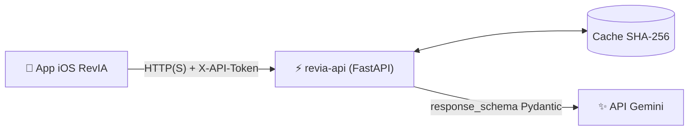

# RevIA — API

**Micro-service FastAPI qui transforme un cours PDF en QCM de révision grâce à l'IA (Gemini).**


> 🚧 **En développement** — Phase 1 : moteur IA

RevIA est composé de deux dépôts : cette API, et le client iOS **[revia-app](https://github.com/pmassereyes/revia-app)**. L'app n'appelle jamais Gemini directement : elle passe par cette API, qui détient la clé, valide les réponses et met en cache.

## Architecture



Pour chaque requête, l'API vérifie le jeton, la taille du PDF et le rate limit, cherche le résultat en cache (empreinte SHA-256 du PDF + paramètres), puis appelle Gemini en lui imposant un schéma de réponse généré depuis les modèles Pydantic.

## Fonctionnalités

- [ ] Prompt de génération validé
- [ ] Schémas Pydantic (QCM, requêtes, erreurs)
- [ ] Fournisseur Gemini : PDF en `inline_data`, `response_schema`, validation de la réponse
- [ ] Route `POST /v1/qcm` avec authentification par jeton, limite de taille et rate limit
- [ ] Erreurs normalisées (jeton, PDF trop lourd, quota, échec Gemini)
- [ ] Cache SHA-256
- [ ] Tests pytest sur une réponse enregistrée, sans consommer de quota
- [ ] Export `docs/openapi.json`
- [ ] Hébergement (accès hors réseau local)

## Choix techniques

**La clé Gemini ne quitte jamais le serveur.** Une clé embarquée dans une app iOS peut être extraite du binaire. Ici, elle vit uniquement dans le `.env` de l'API, et l'app ne connaît qu'une URL et un jeton d'accès.

**Un cache pour préserver le quota gratuit.** Un même PDF demandé avec les mêmes paramètres n'est envoyé qu'une seule fois à Gemini : la réponse est retrouvée par son empreinte SHA-256.

**Un fournisseur d'IA interchangeable.** Les routes dépendent de l'interface `providers/base.py`, pas de Gemini. Basculer vers Mistral ou Groq en cas de baisse des quotas revient à écrire un nouveau fournisseur.

**Une sortie structurée, pas du texte à parser.** Le schéma de réponse imposé à Gemini est dérivé des modèles Pydantic, puis la réponse est revalidée : un QCM mal formé ne peut pas atteindre l'app.


## Contrat d'API

| Méthode | Route | Description |
|---|---|---|
| `GET` | `/health` | État du service |
| `POST` | `/v1/qcm` | PDF (multipart) + nombre de questions → QCM |

Toutes les requêtes `/v1/` exigent l'en-tête `X-API-Token`.

Exemple de réponse (une question) :

```json
{
  "qcm": [
    {
      "question": "Quelle structure de données suit le principe FIFO ?",
      "propositions": ["Pile", "File", "Arbre binaire", "Table de hachage"],
      "indexBonneReponse": 1,
      "explication": "Une file traite les éléments dans leur ordre d'arrivée : premier entré, premier sorti.",
      "theme": "Structures de données"
    }
  ]
}
```

| Code | Signification |
|---|---|
| `401` | Jeton absent ou invalide |
| `413` | PDF trop volumineux |
| `429` | Quota ou rate limit atteint |
| `502` | Échec de l'appel à Gemini |

La spécification complète est dans [`docs/openapi.json`](docs/openapi.json), et la documentation interactive sur `/docs` une fois l'API lancée.

## Lancer le projet

Prérequis : Docker, et une clé API [Google AI Studio](https://aistudio.google.com/).

```bash
git clone https://github.com/pmassereyes/revia-api.git
cd revia-api
cp .env.example .env        # puis renseigner GEMINI_API_KEY et API_TOKEN
docker compose up --build
curl http://localhost:8000/health
```

Sans Docker :

```bash
python -m venv .venv && source .venv/bin/activate
pip install -e .
uvicorn app.main:app --reload
```

Tests :

```bash
pytest
```

## Structure

```
app/
├── main.py           création de l'app FastAPI
├── config.py         lecture de .env
├── auth.py           vérification du jeton
├── schemas.py        modèles Pydantic
├── errors.py         codes d'erreur normalisés
├── cache.py          cache SHA-256
├── routers/          qcm, health
├── providers/        interface + implémentation Gemini
└── prompts/          prompt de génération
tests/                tests pytest et fixtures
docs/openapi.json     contrat d'API
```

## Limites connues

- Palier gratuit de Gemini : les contenus envoyés peuvent être utilisés par Google. RevIA n'est destiné qu'à des supports de cours, rien de confidentiel.
- L'authentification par jeton partagé convient à un usage personnel, pas à une diffusion publique.

## Licence

Tous droits réservés. Le code est consultable mais n'est pas sous licence libre.
